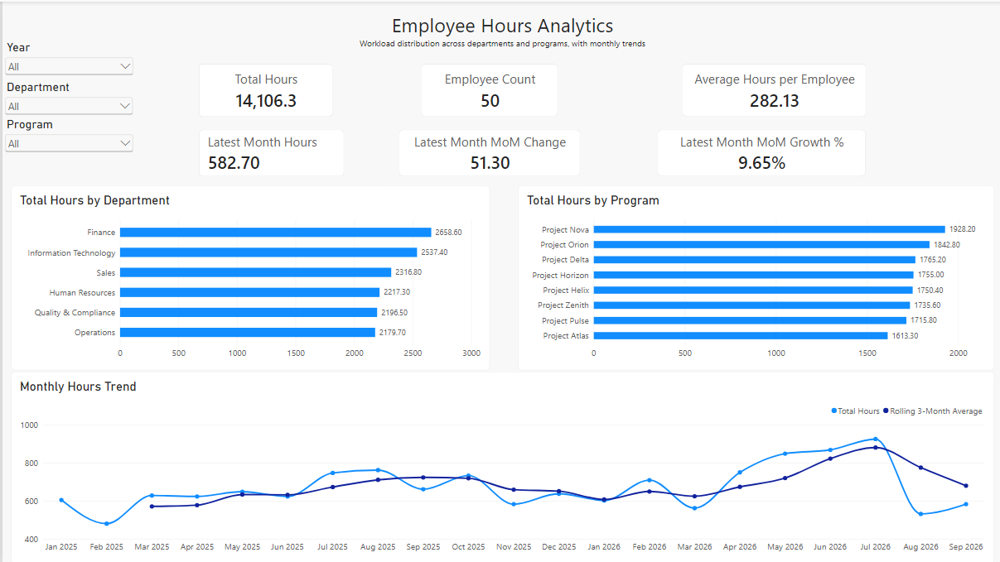
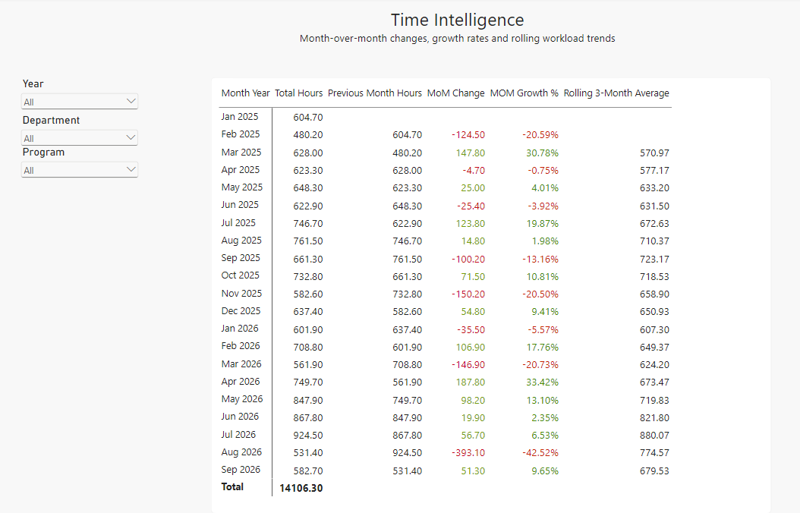

# Employee Hours BI Analytics

## Download the Power BI Report

[Download Employee Hours BI Analytics (.pbix)](https://raw.githubusercontent.com/ishika-analytics/employee-hours-bi-analytics/main/Employee_Hours_BI_Portfolio.pbix)

## Project Overview

An end-to-end Business Intelligence portfolio project built with Power BI using synthetic employee-hours data. The project explores dimensional modeling, DAX calculations, filter context, and interactive analysis.

**Project Status:** Version 1 Completed - Future Enhancements Planned

## Business Objective

Analyze how employees allocate their working hours across departments, programs, and activities. The goal is to provide visibility into workload distribution and enable users to explore data through interactive reporting.

## Technology Stack

- Power BI
- Power Query
- DAX
- GitHub
  
## Data model

The project uses a star schema with one fact table and four dimensions.

```text
                     Dim Employee     
                         |
                         |
    Dim Dates ------ Fact Hours ------ Dim Programs
                         |
                         |
                      Dim Activities

```

### Fact Table

**Fact Hours**

Contains employee-hours records and foreign keys linking to the dimension tables.

**Grain:** One row represents hours recorded for one employee, one program, one activity, on one date.

### Dimension Tables

- **Dim Employees:** Employee, department, role, and location attributes.
- **Dim Dates:** Calendar attributes such as year, quarter, month, and day.
- **Dim Programs:** Program names and categories.
- **Dim Activities:** Activity names and categories.

  ## Dataset

  All data is synthetic and created specifically for learning and portfolio purposes.

| Dataset | Description
|---|---|
| employees.csv | Employee and department information |
| dates.csv | Calendar and reporting attributes |
| programs.csv | Program details |
| activities.csv | Activity details |
| fact_hours.csv | Employee-hours records |

The dataset contains 50 employees, 8 programs, 12 activities, and 2,899 fact records covering January 2025 through September 2026.

## Analytics Implemented

The current Power BI model includes measures for:

- Total hours
- Hours from long entries
- Long-entry record count
- Distinct employee count
- Average hours per employee
- Department-independent total hours
- Percentage of total hours by department and activity

The project also explores DAX filter context, 'CALCULATE()', 'FILTER()', and 'REMOVEFILTERS()'.


## Completed Enhancements

- Built an interactive Power BI dashboard with KPI cards and analytics visuals.
- Added monthly performance KPIs with dynamic Year, Department, and Program filtering.
- Created a Time Intelligence page with MoM comparisons and rolling three-month averages.
- Published dashboard screenshots and documented key project learnings.

## Potential Future Enhancements

- Expand data preparation and data-quality checks.
- Document the complete DAX measure catalogue and data-modeling decisions.
- Further document and validate row-level security configurations.


## Data Disclaimer

This project uses fictional data. It does not contain confidential information from any employer or client.


## Latest-Month Performance KPIs

The Executive Overview includes dynamic monthly performance metrics:

- **Latest Available Date:** Identifies the most recent date with recorded hours under the current filter selections.
- **Latest Month Hours:** Total recorded hours for the latest available calendar month.
- **Previous Month Hours:** Total recorded hours for the preceding calendar month.
- **Month-over-Month Change:** Difference between the latest month's hours and the previous month's hours.
- **Month-over-Month Growth (%):** Percentage change compared with the previous month.

These KPIs dynamically respond to the Year, Department, and Program slicers.

The Time Intelligence page provides monthly totals, previous-month comparisons, MoM changes, growth rates, and rolling three-month averages.

## Dashboard Screenshots

### Executive Overview



### Time Intelligence




